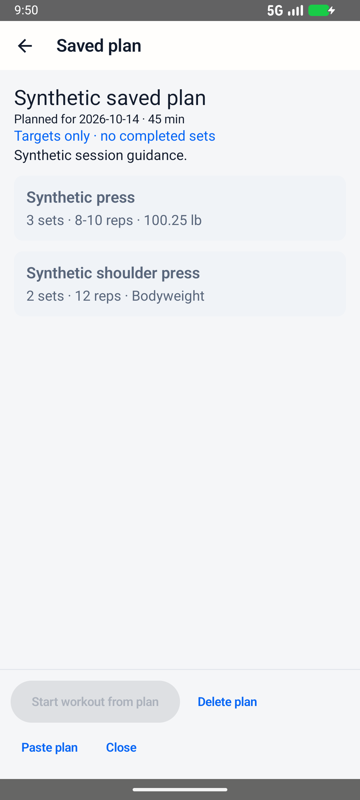
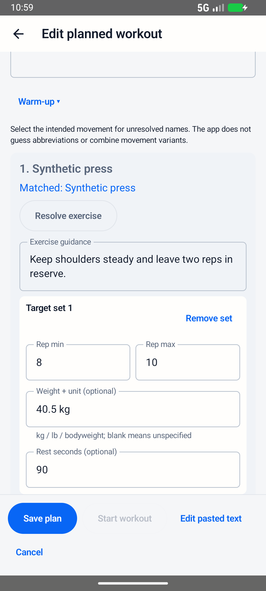
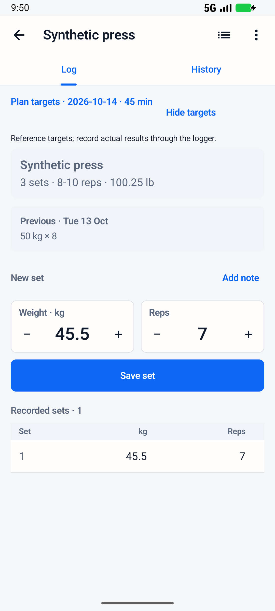
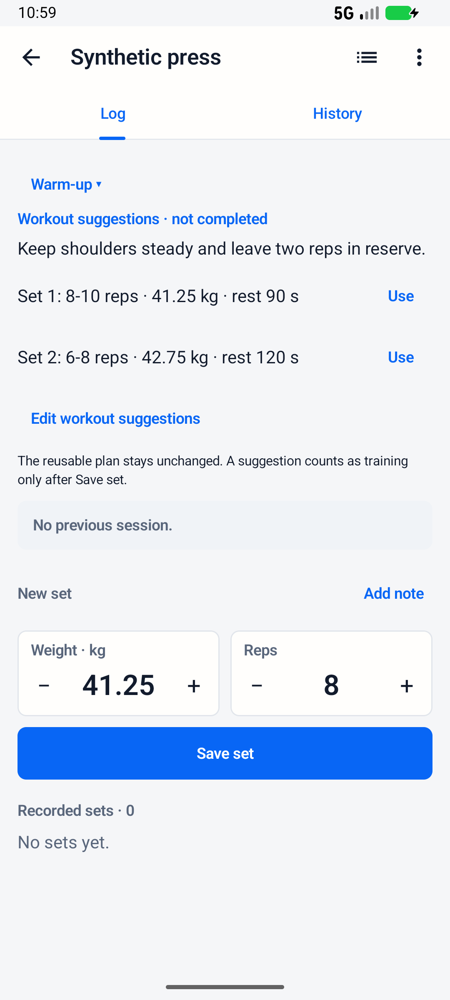

# Editable plans and session lifecycle — 13 October 2026

V1 stored one uniform prescription per exercise and referenced it from one
started workout. V2 stores individual target sets and copies them into a new
workout snapshot only when Start workout is explicitly tapped. Saved plans can
be edited and reused; planning does not create a training session.

## Data and behaviour

- V2 strict JSON: per-set rep minimum/maximum, optional decimal weight/unit,
  optional rest seconds, exercise notes and separate collapsible warm-up guidance.
- V1 still imports; its explicit uniform sets expand into editable rows. Human
  target prose is retained and never parsed into guessed weights or prescriptions.
- Separate Save plan / Start workout actions appear in the editor. Start requires
  a saved, unchanged plan; edited targets must be saved first.
- Save plan creates/updates planning rows only. An optional date and time budget
  can remain blank. The planning editor has no timer, heart-rate import prompt,
  Finish control or completed set records.
- Start workout creates the actual current start time and an active session with
  copied targets/guidance. Repeated taps return that active session. The reusable
  plan is retained, including after a workout finishes and another begins.
- The logger pre-fills editable suggestions and can edit this workout's copied
  targets separately. Only Save set creates actual training. Original target units
  remain intact; lb suggestions copied into the existing kg logger have an explicit
  conversion notice and Use in kg action.
- Convert empty import to plan previews and rechecks older empty suggestions.
  Saving removes their accidental workout/start timestamp. Any recorded sets,
  activity duration/distance/effort, completion or linked health data prevents
  conversion, including training logged after preview. Nothing converts automatically.
- Room 7 → 8 is additive and retains existing actual workouts/sets. Backup v6
  retains individual targets, snapshots and guidance; versions 1–5 remain readable.

## Checks

- 90 local tests: 89 passed, one optional private-history fixture skipped.
- Lint: zero errors, 40 nonblocking warnings. Production debug APK built with the
  existing application ID/signing key.
- New persistence cases verify V2/legacy parsing; optional schedule/weights;
  decimals/units/rest; unknown/malformed fields; import/cancel/edit/save/reopen
  without training; duplicate Start; actual-set-only volume; independent edited
  snapshots; plan reuse; backup v6/old v5 restore; empty legacy conversion; unknown
  legacy targets; rejection of conversion after logging; and migration retaining
  original performed rows.
- Android lifecycle checks verify editable rows, Save/Start double taps,
  close/reopen/edit, suggestions versus actual results, and reviewed conversion.
  They also check that a strength plan opens strength input even when the previous
  session used cardio fields for the same mixed exercise.
- Existing handoff Android checks cover Copy/Share/Paste, manual matching, rotation,
  invalid input, cancellation and deliberate duplicate-plan saves. Lifecycle
  screens also passed at 200% text size in dark mode.
- All fixtures and screenshots use only `com.example.fitnotes.preview.activities`
  on the isolated API 37 emulator. They never enter the personal installation.

## Before and after screenshots

These are actual emulator captures. Before images show the earlier V1 UI;
current images show synthetic V2 examples. Example weights/content differ, so
these comparisons demonstrate presentation and lifecycle rather than conversion
of those particular values.

| Earlier plan | Editable individual targets |
| --- | --- |
|  |  |

| Earlier logger reference | Copied editable suggestions, zero recorded sets |
| --- | --- |
|  |  |

- [Saved unscheduled plan, no training](screenshots/per-set-plans/after-saved-plan-no-training.png)
- [One actual set logged with different weight/reps](screenshots/per-set-plans/after-actual-set-logged.png)
- [Empty older import before conversion](screenshots/per-set-plans/before-empty-legacy-import.png)
- [Conversion preview retaining ambiguous legacy instructions](screenshots/per-set-plans/after-legacy-conversion-preview.png)

## Physical update

The authorised Pixel 6 accepted an update with the existing application ID and
signing key. Room opened version 8. Before/after totals matched for local/original
workouts, sets, exercise catalogue, measurements, history imports, source links
and cached heart-rate samples. No uninstall, data clearing, synthetic fixtures or
automatic conversion of the phone's sessions was performed.
