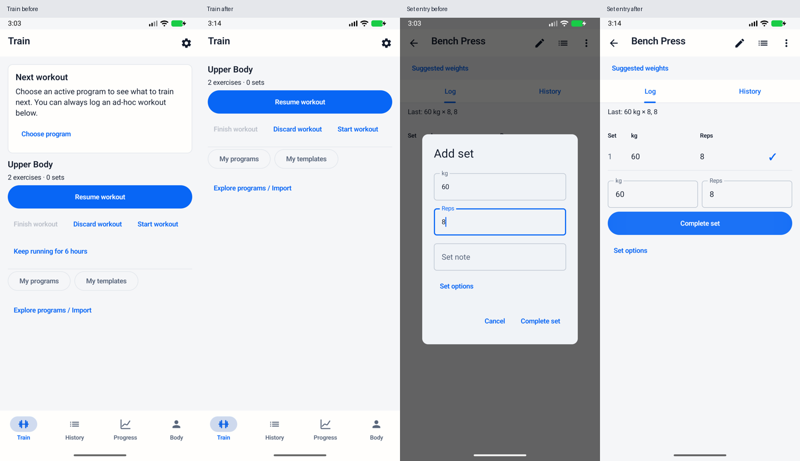

# UI audit — 28 October 2026

Baseline: `63e89df` (main, 1.1.5). API 37 ARM emulator, 1080 × 2400,
420 dpi, light theme, font scale 1.0. All captures use synthetic Bench Press,
Seated Cable Row and Upper Body sessions; no personal training data.
Coach is audited separately from an isolated snapshot of the unmerged
`feature/coach-training-queue` work. It is not part of main or this PR.

Severity: High blocks/slows the core gym task; Medium adds repeated friction or
weakens hierarchy/accessibility; Low is a local clarity issue. This is an expert
inspection, not a user study or a claim of complete accessibility conformance.

| Severity | Finding and evidence | Concrete improvement |
| --- | --- | --- |
| High | Train puts a large program placeholder before Start/Resume, including while a workout is active. [Empty](before/train-empty.png), [active](before/train-active.png). | Omit the empty card; put Resume first and show the next program only when no workout is active. Keep program management visible. |
| High | Freeform sets require Add set → dialog → re-enter values → Complete for every set. An always-visible note field distracts from weight/reps. [Logger](before/logger-empty.png), [editor](before/set-editor.png). | Put weight/reps and Complete set inline for ordinary local strength sets; retain values after each save. Keep a labeled Set options action for cardio, notes and load modes; preserve row editing. |
| Medium | Saved template detail has eight footer actions with weak hierarchy. The list repeats a paragraph explaining implementation semantics and nests a title button inside a card. Start also waits an arbitrary 1.5 seconds after opening a template (source inspection). [List](before/plans-list.png), [detail](before/plan-detail.png). | Keep Start/Edit prominent; use a labeled Plan actions menu for occasional management; make each list row easy to tap, remove repeated prose, and enable Start as soon as the template is loaded. Keep target/actual distinction concise. |
| Medium | Planned weight/reps fields and completion checkboxes rely on table position for their accessible names; Progress uses a bare info glyph. | Add set-specific accessible labels and a descriptive metric-information label; preserve 48 dp interaction sizes. |
| Low | Empty Progress shows a disabled exercise picker and date controls without records. [Empty Progress](before/progress-empty.png). | Show the empty message and Strength/Running switch; introduce exercise/date controls when there are records. |
| Low | Coach repeats its screen purpose and includes a privacy paragraph in the action flow; two filled actions compete in the same view. [Coach](coach/coach.png), [empty](coach/coach-empty.png). | In the Coach follow-up, shorten the intro, put optional sharing detail with View shared data, and make Paste secondary. Audit only here to avoid mixing concurrent feature changes. |
| Low | Train and the app scaffold both render the active rest timer, and a six-hour extension is always promoted on Train (source inspection). | Keep one timer in the app footer; move the occasional extension to the workout menu. |

History's filter, active-workout date navigation and populated Progress remain
compact and useful; retain their structure.

Evaluation criteria: Material hierarchy and accessible standard components;
Nielsen visibility of state, recognition, efficiency and minimalism; Android
labels, non-colour status cues and 48 dp touch targets.

- [Material accessibility](https://m3.material.io/foundations/accessible-design/overview)
- [Nielsen's usability heuristics](https://www.nngroup.com/articles/ten-usability-heuristics/)
- [Compose accessibility defaults](https://developer.android.com/develop/ui/compose/accessibility/api-defaults)
- [Android accessibility principles](https://developer.android.com/guide/topics/ui/accessibility/principles)

Before captures cover normal/empty Train, templates, History and Progress, an
active workout, empty/recorded exercise logging and the set editor. Coach's
normal/empty request and response-action captures are included separately.

## Implemented in this PR

| Screen | Before | After |
| --- | --- | --- |
| Train, no program | [Empty](before/train-empty.png) | [Empty](after/train-empty.png) |
| Train, active session | [Before](before/train-active.png) | [After](after/train-active.png) |
| Train, active program | [Before](before/train-program.png) | [After](after/train-program.png) |
| Set logging | [Dialog](before/set-editor.png) | [Inline entry and saved set](after/logger.png) |
| Saved templates | [List](before/plans-list.png) / [Detail](before/plan-detail.png) | [List](after/plans-list.png) / [Detail](after/plan-detail.png) |
| Empty Progress | [Before](before/progress-empty.png) | [After](after/progress-empty.png) |

Routine freeform repeats now take one Complete set tap with values retained.
Session/date selection, advanced set modes, notes, editing, exports and confirmed
deletion remain available. Start/Edit stay visible on templates; occasional
management uses the labeled Plan actions menu. No persistence format or schema
changes. [Test results and reproduction](verification.md).

[Dark mode at 150% text](large-dark/logger-keyboard.png) keeps set completion
reachable with the keyboard open. [Large-text template actions](large-dark/plan-detail.png)
wrap without clipping.
